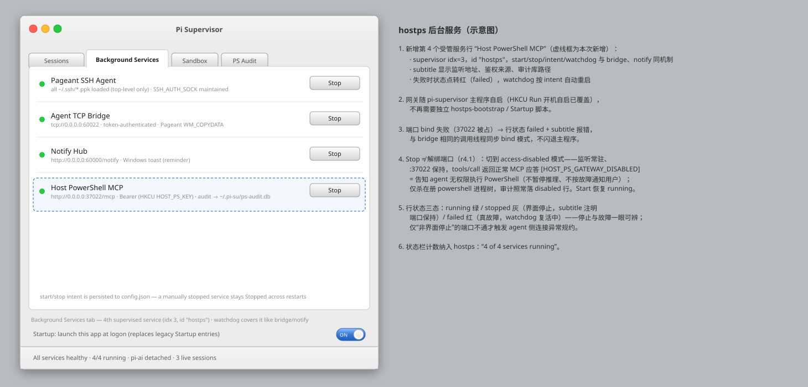
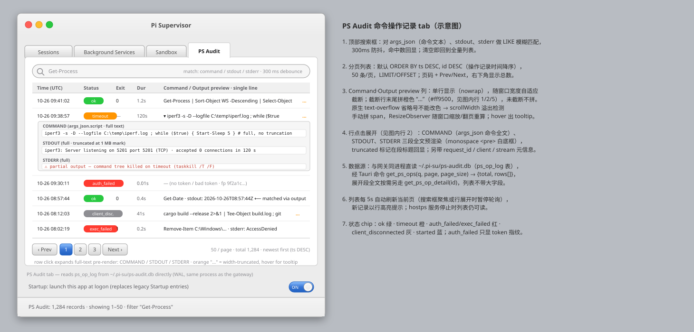

# pi-supervisor 宿主 PowerShell MCP 网关 + 命令操作记录 — 开发计划

- 日期：2026-10-23（r2：新增 SSE 输出流式回传设计；r3：HOST_PS_KEY 改存宿主 User 环境变量，经 sbx custom secret 引入，取消 token 文件下发通道）
- r4（2026-10-26）：**载体变更**——不再新建宿主机独立 Python 服务（`~/.host-ps-gateway/`），改为在 **pi-supervisor 内新增后台 MCP 服务**（Rust 模块 `services/hostps.rs`，与 pageant/bridge/notify 同为受管服务）；**新增 "PS Audit" tab 页**分页展示命令操作记录（搜索 + 时间降序）；审计库路径改 **`~/.pi-su/ps-audit.db`**，表名改 **`ps_op_log`**。
- r4.1（2026-10-26）：**停止语义拆分**——界面 Stop ≠ 释放端口：监听保持、对调用返回正常 MCP 结果 `[HOST_PS_GATEWAY_DISABLED]`，agent 据此视作用户未授权（**继续任务、无需暂停推理、无需按故障通知用户**）；仅当**未经界面停止**（intent=running）而端口访问不通（拒连/超时/断流）时，才按 §3.3/§6 连接异常规约暂停推理并通知用户。
- 状态：计划（未实施）
- 目标：sbx 沙箱 `pi-ai` 内的 pi-agent 通过 MCP 调用 Windows 宿主机 PowerShell，采用轻量 RPC 连接方式；输出支持 SSE 流式回传；连接异常时给出明确提示、指引 agent 暂停推理并通知用户；本期**不做命令级权限控制/黑白名单**；全部操作落 SQLite 审计库 `~/.pi-su/ps-audit.db`；pi-supervisor 主窗口新增 tab 页以分页列表展示/检索操作记录。

---

## 1. 总体架构

```
pi-ai 沙箱 (microVM)                      Windows 宿主机 = pi-supervisor (Tauri, Rust)
┌─────────────────────────┐   ┌───────────────────────────────────────────────┐
│ pi ── mcp.json           │   │ supervisor 受管服务 idx=3  id="hostps"          │
│  host-powershell:        │   │  ├─ /mcp  HTTP 监听 (:37022, 线程内 std::net)   │
│   http://host.docker.    │◀──│  ├─ Bearer 鉴权（热读 HKCU\Environment）        │
│   internal:37022/mcp     │   │  ├─ tools/call → powershell -EncodedCommand    │
│  header ${HOST_PS_KEY}   │   │  │   （子进程，双管道双读线程）                 │
│  （沙箱内只见占位符）      │   │  ├─ 响应双形态：JSON / SSE 流                  │
│ sbx custom secret 注入占位符│  │  └─ 审计 → ~/.pi-su/ps-audit.db (ps_op_log)   │
└─────────────────────────┘   │                     ▲ 同进程直读（WAL）          │
   egress 代理把占位符换成真值  │  主窗口 "PS Audit" tab：分页列表 + 搜索 ◀───────┘
                              └───────────────────────────────────────────────┘
```

连接方式选型：**MCP Streamable HTTP、无会话（stateless）模式** —— 单端点 `POST /mcp`；响应双形态：`Accept: application/json` → 一次性 JSON 应答；`Accept` 含 `text/event-stream` → SSE 流式应答（见 §3.5）。协议本身就是 JSON-RPC 2.0，满足"相对轻量级的 RPC"，且 pi 1.x 原生 MCP 客户端直接支持。

- 服务载体：**pi-supervisor 内置 Rust 服务模块**——`std::net::TcpListener` 手写极简 HTTP/1.1（与 `services/bridge.rs`、`services/notify.rs` 同一实现范式），JSON 用已有 `serde_json`，SQLite 新增 `rusqlite`（bundled）依赖，子进程用 `std::process::Command`。MCP 协议层独立成 `services/mcp_wire.rs` 单模块（JSON 与 SSE 分支都收在这里）。
- 生命周期复用 supervisor 既有机制：**start/stop/intent 持久化（config.json `services.hostps`）+ 3s watchdog 自动重启**；开机自启即 pi-supervisor 自身的 HKCU Run 项（**不再需要 hostps-bootstrap / Startup 脚本**）。
- **端口进程存活期全程占用、不随服务 Stop 释放（r4.1）**：界面 Stop 只切到 access-disabled 模式（§3.4）。效果：agent 侧能可靠区分两种世界——"用户在界面停掉了"（收到结构化 DISABLED 应答 = 无权限，继续干活）vs "网关没被停却访问不通"（ECONNREFUSED/超时 = 连接异常，暂停并通知用户）。
- 端口默认 **37022**（可 config 覆盖）。bind `0.0.0.0` + `::`（沿用 bridge.rs 双栈双 listener 实测经验），bind 在调用线程同步做（端口冲突即时报 failed，不影响主程序），安全性依赖：token 强制鉴权 + Windows 防火墙规则限制入站仅 sbx 虚拟网卡网段。

## 2. 组件与改动清单

| # | 位置 | 内容 |
|---|------|------|
| A | `src-tauri/src/services/hostps.rs` + `mcp_wire.rs` | MCP HTTP 服务 + 协议/传输层；审计写入；日志 `%APPDATA%\pi-supervisor\logs`（复用 supervisor 日志设施）|
| B | `src-tauri/src/supervisor.rs` `state.rs` `config.rs` | 第 4 个受管服务（idx=3，id `hostps`）：start/stop/intent/watchdog/ServiceInfo（subtitle 显示 `http://0.0.0.0:37022/mcp · Bearer(HKCU HOST_PS_KEY) · audit → ~/.pi-su/ps-audit.db`）；Stop/Start = running/disabled 模式切换，监听不解绑（§3.4）|
| C | `src-tauri/src/psaudit.rs` + `commands.rs` | 审计库打开（WAL）+ 查询命令 `get_ps_ops`（分页/搜索，§5.3）；首次启动幂等建库建表 |
| D | `src-tauri/Cargo.toml` | 新增 `rusqlite = { features = ["bundled"] }`；windows crate 加 `Win32_System_Registry` feature（读 HOST_PS_KEY）|
| E | `src/types.ts` `api.ts` `App.svelte` `components/PsOpsPanel.svelte` | `ServiceId` 加 `"hostps"`；`TabId` 加 `"psops"`；TABS 4 项、tab-track 改 `100/4`；新记录面板组件（§5）|
| F | 宿主机 `~/.pi-su/ps-audit.db` | 审计库（首次启动创建；原 `~/.host-ps-gateway/audit.db` 方案作废）|
| G | `pi-build/pi-agent/spec.yaml` | 网络白名单加 `host.docker.internal:37022`；描述文字更新；credentials 块补 HOST_PS_KEY 说明 |
| H | `pi-build/pi-agent/files/home/.pi/agent/mcp.json` | 新增 `host-powershell` server（url + `Bearer ${HOST_PS_KEY}`）|
| I | 宿主机 User 环境变量 `HOST_PS_KEY` + sbx custom secret | `SetEnvironmentVariable(...,'User')` 存真值；`sbx secret set-custom --host host.docker.internal --env HOST_PS_KEY --command "powershell [Environment]::GetEnvironmentVariable('HOST_PS_KEY','User')"`（同 MCP_AUTH_KEY 机制，on-demand 读取，真值不落盘不进沙箱）|
| J | 防火墙规则 | hostps 首次启动时幂等确保：`New-NetFirewallRule` 入站放行 TCP 37022，remote address 限定 sbx/vEthernet 宿主机网段（`Get-NetIPConfiguration` 实测确定），不放开公网 |
| K | kit `AGENTS.md`（spec.yaml agentInstructions → 同步生成 `files/home/.pi/agent/AGENTS.md`）| 新增"宿主 PowerShell MCP 使用规约"（见 §6）|
| L | （可选 P3）`files/home/.pi/agent/extensions/host-ps-guard` | pi 扩展：拦截该 MCP 工具的连接类错误，注入暂停提示 |
| M | spike 脚本（沙箱内 curl 验证 SSE） | SSE 通路验证（egress 代理 + pi 客户端能力，见 §3.5.4，P0 门禁）|

> ~~原 r3 方案的 A/E/H 项（宿主机独立 Python 服务、hostps-bootstrap 自启、hostps-log.ps1）全部作废或被取代：自启并入 pi-supervisor 本体（B/F），审计查询辅助（H 项）被 "PS Audit" tab 页取代（E 项）。~~
> 镜像注意：H/K 走 kit overlay 注入，create 时即生效，无需重建镜像（token 走 env 占位符后 pi wrapper 无需改动，镜像零改动）。G/I 改动后沙箱需 `sbx rm && sbx create` 重建——网络白名单在 create 时固化，custom secret 的 placeholder 同样只在 create 时注入沙箱 env（既有实证：set-custom 不会回填运行中的沙箱）。

## 3. hostps 服务实现（P0 核心）

### 3.1 MCP 面（工具定义）

JSON-RPC 方法：`initialize`、`notifications/initialized`、`ping`、`tools/list`、`tools/call`。stateless：不签发 `Mcp-Session-Id`，若客户端携带则原样回显。协议版本按客户端 `initialize.protocolVersion` 协商，回落 `2025-03-26`。

`initialize` 的 server capabilities 声明 `tools`；响应 `serverInfo.name = host-ps-gateway`（对外名称保持稳定，pi 侧规约不感知载体变化）。

工具 1 —— `powershell`（执行宿主命令）：

```json
{
  "name": "powershell",
  "description": "Execute a PowerShell script on the Windows HOST and return stdout/stderr/exit_code. If this call fails with a [HOST_PS_GATEWAY_*] error, STOP reasoning about this task and report the MCP connection problem to the user.",
  "inputSchema": {
    "type": "object",
    "properties": {
      "script":  {"type": "string", "description": "PowerShell script text"},
      "timeout_seconds": {"type": "integer", "default": 120, "maximum": 600}
    },
    "required": ["script"]
  }
}
```

工具 2 —— `health`（连通性探针，供 agent 首次使用前/异常后自检）：返回 `{host_name, ps_version, uptime, db_ok, sse_ok, disabled}`（`sse_ok` = 服务端 SSE 通路自检通过标志，见 §3.5.4；`disabled` = 服务已被界面停止，见 §3.4——health **正常应答**且 `disabled:true`，不是错误，agent 按"无权限"处理而非按连接故障处理）。disabled 模式下 `tools/list` 返回原工具列表（保持 pi 连接正常、工具存在），仅 `tools/call` 拒绝执行。

执行细节：
- 脚本经 **`powershell.exe -NoProfile -NonInteractive -EncodedCommand <base64 UTF-16LE>`** 传递，杜绝引号/换行注入拼接问题；`CREATE_NO_WINDOW`（复用 util 里既有 flag 常量）。
- stdout/stderr 分别捕获（两个管道、两个读线程，输出强制 UTF-8：子进程 env 注入 `PYTHONIOENCODING` 无意义，改为在脚本前 prepend `[Console]::OutputEncoding=UTF8`）；退出码原样返回。
- 超时（默认 120s、上限 600s）`taskkill /T /F` 杀进程树；**超时时已捕获的部分输出随错误一起返回**（批式与流式都如此），标注 `timeout`。
- 输出回传 MCP 截断到 ~64KB（截断标注），**审计库另存 ≤1MB**（见 §4）。
- supervisor Stop（关服务）时：**不停 accept 循环**（保持 disabled 应答器，§3.4），只做模式切换 + 对在册子进程逐个杀进程树，杜绝孤儿 powershell。

### 3.2 鉴权（sbx custom secret 通道）

- 真值存**宿主机 User 环境变量 `HOST_PS_KEY`**（32B hex，`SetEnvironmentVariable(...,'User')`）；建 sbx custom secret（target `host.docker.internal`，env `HOST_PS_KEY`，on-demand command 读同一 User 变量）——与 MCP_AUTH_KEY 完全同机制。
- 链路：沙箱内 `HOST_PS_KEY` 只见 `sbx-cs-...` 占位符 → pi 展开 mcp.json 的 `Bearer ${HOST_PS_KEY}` 发出占位符 → **egress 代理对 `host.docker.internal:37022` 的请求替换为真值** → 网关收到真值。真值不进沙箱、不落盘。
- 网关侧校验：**每请求经 winreg 直读 `HKCU\Environment` 的 `HOST_PS_KEY`**（windows crate `Win32_System_Registry`；服务进程自身 env 不反映运行期变量修改，必须读注册表而非 `std::env`）→ 轮换 = 改 User 环境变量一步完成，网关与 secret 均 on-demand 读取，零重启、零推送。
- 缺失/错误 → HTTP 401 + JSON `{"error":{"code":-32001,"message":"[HOST_PS_GATEWAY_AUTH] invalid token"}}`，并记 `auth_failed` 审计行（不落 token 明文，只落前 6 位指纹）。审计里出现 `sbx-cs-` 前缀指纹 = 占位符未被替换的专属特征，直接指向 egress secret 未生效（见 §7 P1 验收）。

### 3.3 连接异常语义（本项为重点需求）

服务端能表达的异常，统一用 MCP tool result `isError=true` + 带机器可读前缀的文案，**前缀分两类，agent 行为完全不同**：

**A 类·连接/故障类**（agent → 暂停推理、通知用户）：
`[HOST_PS_GATEWAY_UNREACHABLE]`（预留，客户端侧用）、`[HOST_PS_GATEWAY_AUTH]`、`[HOST_PS_GATEWAY_EXEC_FAILED]`、`[HOST_PS_GATEWAY_TIMEOUT]`、`[HOST_PS_GATEWAY_LOG_FAILED]`（审计写失败——**拒绝执行并报错**，审计不可用视为故障而非静默放行）。文案模板：

> `[HOST_PS_GATEWAY_*] …… — ACTION FOR AGENT: pause this task, do NOT retry more than once, do NOT fabricate results or substitute sandbox-local commands; notify the user that the host-powershell MCP is unavailable and include this error.`

**B 类·权限/停用类**（agent → **不暂停、不报障**，r4.1）：
`[HOST_PS_GATEWAY_DISABLED]` —— 用户在 pi-supervisor 界面主动停止了 hostps（§3.4 disabled 模式返回，HTTP 200 正常 MCP 应答、非 401/403，保证 pi 客户端拿到的是协议内 result）。专用文案模板：

> `[HOST_PS_GATEWAY_DISABLED] Host PowerShell access is turned OFF by the user in Pi Supervisor — this is an intentional user setting, NOT a connection failure. ACTION FOR AGENT: you currently have NO permission to run host PowerShell; do NOT pause this task, do NOT report an incident; continue with sandbox-local tools and simply mention that host PowerShell is switched off.`

`health` 在 disabled 模式返回 `disabled:true`（正常 result），agent 侧同等处理。审计照常落行 `status=disabled`。

SSE 流中断的异常语义：流式响应中途服务端侧故障（子进程崩、审计写失败）→ 在断流前**尽力补发一个最终 `tools/call` result 帧**（`isError=true` + 上述前缀文案）再关流；来不及补发就断的，由客户端按"连接异常"处理（§3.5.3）。

服务端**宕机/不可达**这类网关自身无法发声的异常（注意：界面 Stop 不在此列——它有 DISABLED 结构应答），由客户端两层兜底：
1. **AGENTS.md 规约**（K 项，见 §6）：任务首次使用宿主 PowerShell 前必须先调 `health`；任何 `mcp__host-powershell__*` 调用失败/工具不存在/连接错误/**流非正常结束（收到部分帧未收到最终 result 帧）** → 立即暂停该任务推理，向用户报告，不得编造结果、不得绕道本地命令假装完成。**唯一例外**：返回带 `[HOST_PS_GATEWAY_DISABLED]` 前缀或 `health.disabled=true` → 视为用户未授权，不暂停、不报障（§3.3 B 类）。
2. **（可选 P3）pi 扩展 host-ps-guard**：订阅工具执行事件，识别 `mcp__host-powershell__*` 的结果中的连接错误特征（含 pi MCP 客户端层面的 ECONNREFUSED/超时/401/SSE 断流），在对话流注入一条醒目提示行并强制 agent 下一轮先向用户报告。P3 视 P2 规约的实际约束力决定是否实施。

载体变化带来的兜底增益：网关跑在 pi-supervisor 里，**supervisor 的 Background Services tab 直接可见 hostps 状态（running/failed）、watchdog 自动复活**——连接异常首先可由用户在主窗口看到并重启。

### 3.4 生命周期与防火墙

- **双模单监听（r4.1 核心）**：listener + accept 循环绑定 **supervisor 进程存活期**（setup 期建立、watchdog 保活），37022 全程占用，**不随服务 Stop 解绑**。内部 `enabled: AtomicBool` 由界面 Start/Stop 切换并持久化为 intent：
  - **running（enabled）**：请求走完整网关路径（§3.1–§3.3）；
  - **stopped（disabled 模式）**：不执行任何命令，`tools/call` 一律返回 `[HOST_PS_GATEWAY_DISABLED]` 正常应答（§3.3 B 类），`health` 应答 `disabled:true`，审计落 `status=disabled`；Stop 的即时动作 = 对在册 powershell 子进程逐个杀进程树（accept 循环不停）。
- 自启：随 pi-supervisor 启动，`start_saved` 按 config.json `services.hostps` intent 决定初始模式（默认 on=running）；手动 Stop 持久化为 off，重启后仍是 disabled 模式（端口照占、应答 DISABLED）——intent 持久化语义与 bridge/notify 同构，端口占用性除外。
- watchdog：3s 巡检，worker 线程退出 → 状态翻 `failed` → intent 为 on 时自动重启（复用 `supervisor::spawn_watchdog`，索引数组扩为 `["pageant","bridge","notify","hostps"]`）；**accept 循环与 intent 无关始终保活**——disabled 应答器也必须活着，否则界面已停止的沙箱侧会退化成 ECONNREFUSED 连接错误、误触发暂停规约。
- UI 状态区分：行状态 `running`（绿）/ `stopped`（灰，subtitle 注明 `:37022 access-disabled — 界面已停止，端口保持`）/ `failed`（红，真故障，watchdog 复活中）。"停止"与"故障"在主窗口一眼可辨。
- 防火墙：hostps start() 内幂等确保入站规则（J 项）；添加失败不阻塞启动，subtitle 提示"防火墙规则需手动放行"。

### 3.5 SSE 输出流式回传（r2 设计，载体平移）

目标：长输出/长耗时命令执行期间，agent 侧可增量看到输出与进度，而非 120s 后一次性回传或超时全丢。**响应形态按客户端能力自动协商，流式不可用时整条链路自动回落批式 JSON，行为与 r1 完全一致。**

#### 3.5.1 协商规则（mcp_wire.rs 内实现）

- `tools/call` 且 `Accept` 仅含 `application/json` → 批式 JSON（默认路径，零变化）。
- `Accept` 含 `text/event-stream` 且 `params._meta.progressToken` 存在 → **SSE 流式**；
- `Accept` 含 `text/event-stream` 但无 `progressToken`（MCP 规范：progress 通知必须挂在 token 上）→ 仍走 SSE 容器，但只发一帧最终 result（等价批式，不换协议语义）；
- 非 `tools/call` 方法（initialize/tools/list/ping/health）恒 JSON，不进流。

#### 3.5.2 SSE 帧设计

```
Content-Type: text/event-stream + Transfer-Encoding: chunked + Cache-Control: no-cache + X-Accel-Buffering: no

帧 1（立即）      ：SSE 注释帧 ": stream-open\n\n"                    —— 探活/顶穿缓冲代理，不算协议消息
进度帧（节流）    ：event: message → {"jsonrpc":"2.0","method":"notifications/progress",
                    "params":{"progressToken":T,"progress":<已产出字节数>,
                              "message":"<stdout+stderr 累计尾部，≤2KB>",
                              "_stream":{"stdout_chunk":"…","stderr_chunk":"…"}}}
                    节流策略：每 2s 或有新增 ≥8KB 时合帧（先到者触发），stdout/stderr
                    双线程的增量汇入同一 mpsc::channel、单线程写流，保证帧序与线程安全
最终帧（必有）    ：event: message → 该 request id 的 tools/call result（完整 content，
                    含全文输出 + 截断标注 + exit_code）——与批式路径同一构造函数，客户端
                    消费/不消费进度帧都不影响正确性
keepalive        ：静默 ≥15s 时发 SSE 注释帧 ": ping\n\n"（防代理空闲掐断），非协议消息
```

进度帧的 `_stream` 增量字段是自定义扩展（progress 通知允许附加字段）：MCP 客户端若只认 `progress/message` 也能用；若 pi 不显示 progress，流式的价值退化为"保活到长命令跑完"（600s 内不再被代理/客户端超期中断），仍为正收益。

chunked 编码手写：每帧 `write!(stream, "{:x}\r\n", len)` + 帧体 + `\r\n` 后 `flush()`（std::net 无自动分帧，长度前缀逻辑收在 mcp_wire.rs）。

#### 3.5.3 实现要点（Rust，线程模型）

- 每连接一线程（bridge.rs 同款 spawn + catch_unwind）：起子进程（stdout/stderr 双管道双读线程）→ 输出块入 `mpsc::channel` → 连接线程按节流策略组帧写出 + flush；HTTP 请求解析（请求行/头/Content-Length 体）为 mcp_wire.rs 内 ~100 行手写。
- **超时**：到点杀进程树（`taskkill /T /F`），把**已捕获的部分输出**随 `[HOST_PS_GATEWAY_TIMEOUT]` 的最终 result 帧发出，再关流。
- **客户端断连**：写流遇 `BrokenPipe`/`ConnectionReset`（Windows WSAECONNRESET）→ 杀进程树 + 落审计 `status=client_disconnected`（部分输出照常入库），不留孤儿 powershell 进程——流式实现最容易漏的点，验收单列 T5b。
- **审计与流的关系**：审计只在**终态**落一行（含 status 区分 `ok/timeout/exec_failed/log_failed/client_disconnected`），进度帧不逐帧写库（写放大且无回放价值）；`args_json` 与最终 stdout 入库逻辑与批式完全同路。LOG_FAILED 语义不变：进入 tools/call 即先抢占式落 `status=started` 行，终态 UPDATE——写不进去当场拒绝执行。
- **锁模型**：审计写经 `Mutex<Connection>` 单连接串行（WAL 下写锁本就单写者，跨 UI 查询与网关写入同一 `Database` 句柄共享，开在 psaudit.rs，§5.3）。
- 流式路径**必须**通过 §3.3 的补发规则收敛：凡是建立了流的请求，除进程级崩溃外必须见到最终 result 帧后才关流。

#### 3.5.4 通路验证（P0 门禁，先测后建）

两个外部未知数必须在 P0 前用 spike 脚本实测，任何一项不通都不阻塞 r1 批式功能（自动回落），但阻塞"流式"验收：

1. **sbx egress 代理对 SSE 长响应**：沙箱内 `curl -N` 打宿主 spike 端点，验证①分帧即时到达（不被整包缓冲）、②静默 20s+ 不被代理掐断（keepalive 注释帧生效）、③`HostConnection: none` 类缓冲行为。60022 裸 TCP 通**推不出**此项，必须实跑 HTTP+SSE。（spike 端点可直接用 hostps 的 `/mcp` 假流自检路径，见 3.5.5。）
2. **pi MCP 客户端**：`tools/call` 是否携带 `_meta.progressToken`、`Accept` 是否含 `text/event-stream`、收到 progress 通知是否报错（有的客户端对未知通知打 warn 或断开）。用 `pi mcp list` + 真实会话观察 `~/.pi/agent/mcp.log`。
3. spike 结论三分记录进本文档：**全通** → 流式默认启用；**代理通/pi 不消费** → 仍启用（保活价值 + 日志噪音评估后定 progress 帧频率）；**代理缓冲或掐断** → 配置项 `services.hostps_sse = off`，走 r1 批式并记录实测证据。

#### 3.5.5 配置项

config.json `services.hostps_sse = "auto" | "force" | "off"`（默认 auto：按 §3.5.1 协商）。`health.sse_ok` 反映服务端流自检（进程内自连一发 SSE 假流）结果，agent 侧规约不变。端口覆盖：`services.hostps_port`（默认 37022）。

## 4. 审计库（`~/.pi-su/ps-audit.db`）

路径 **`~/.pi-su/ps-audit.db`**（`%USERPROFILE%\.pi-su\`，首次启动幂等建目录建库），WAL + `synchronous=NORMAL`（rusqlite bundled），启动时幂等建表：

```sql
CREATE TABLE IF NOT EXISTS ps_op_log (
  id          INTEGER PRIMARY KEY,
  ts          TEXT NOT NULL,          -- UTC ISO8601
  request_id  TEXT,                   -- 每次 JSON-RPC 请求 uuid
  client      TEXT,                   -- 来源 IP:port + User-Agent
  method      TEXT NOT NULL,          -- initialize / tools-call / ping ...
  tool        TEXT,                   -- powershell / health
  args_json   TEXT,                   -- 完整入参（script 全文，不截断）
  exit_code   INTEGER,
  stdout      TEXT,                   -- ≤1MB，超出截断并置 stdout_truncated
  stdout_truncated INTEGER DEFAULT 0,
  stderr      TEXT,                   -- ≤256KB
  duration_ms INTEGER,
  stream      INTEGER DEFAULT 0,      -- 1 = 本次经 SSE 流式回传
  status      TEXT NOT NULL,          -- started→ok | tool_error | exec_failed | timeout | auth_failed | log_failed | client_disconnected | disabled（界面停止模式下的来电，§3.4）
  error       TEXT
);
CREATE INDEX IF NOT EXISTS idx_psop_ts    ON ps_op_log(ts);
CREATE INDEX IF NOT EXISTS idx_psop_tool  ON ps_op_log(tool);
CREATE INDEX IF NOT EXISTS idx_psop_stat  ON ps_op_log(status);
```

- 覆盖范围：**每一次** JSON-RPC 请求都落行（含未过鉴权的 `auth_failed`、`tools/list`、`ping`），保证"谁在何时执行了什么宿主命令"完整可回放；`args_json` 存脚本全文不截断。tools/call 采用 started(INSERT)→终态(UPDATE) 两段式（§3.5.3），进程崩溃也能留下 started 痕迹。
- 写库失败 → 本次执行直接失败（§3.3 `LOG_FAILED`），不允许无痕执行。
- 保留策略：启动时 + 每 24h 清理 30 天前记录（`ts` 索引），VACUUM 阈值触发。
- ~~查询辅助 H 项（hostps-log.ps1）~~ → 由主窗口 "PS Audit" tab 页承担（§5），WAL 下与网关写入并发安全（同进程共享连接 + `Mutex<Connection>` 串行写）。

## 5. PS Audit tab 页（命令操作记录，r4 新增）

### 5.1 示意图

**Background Services tab（新增 hostps 服务行）：**



**PS Audit tab（命令操作记录列表）：**



（源文件：`plan-assets/pi-ps-mcp-mockup-*.svg`，矢量可放大核对色值/间距；色值取自 theme.css 变量，与既有 mockup 同一套 Aqua 皮肤。）

### 5.2 前端（Svelte 5）

- `types.ts`：`TabId` 扩为 `"sessions" | "services" | "sandbox" | "psops"`；`ServiceId` 加 `"hostps"`。
- `App.svelte`：`TABS` 加第 4 项 `{ id: "psops", label: "PS Audit" }`；tab-track 位移改 `translateX(-{activeIndex * (100 / 4)}%)`（注意既有实证坑：track 不得 flex-shrink，面板宽度按 1/4 计）。
- 新组件 `components/PsOpsPanel.svelte`：
  - **顶部搜索框**：占位符 "search command / stdout / stderr"；输入 300ms 防抖触发查询，右侧回显命中总数；清空按钮回全量。
  - **分页列表**：列 = 时间（UTC，本地化显示）/ 状态 chip（`ok` 绿、`timeout` 橙、`auth_failed`/`exec_failed` 红、`client_disconnected` 灰、`disabled` 深灰、`started` 蓝）/ 退出码 / 耗时 / Command·Output preview（`disabled` 行即界面停止期间的来电记录）。**默认 ORDER BY ts DESC（操作记录时间降序）**，同秒并列以 `id DESC` 稳定次序。
  - **Command·Output preview 列单行显示**：取 args_json 里 script 首行，`white-space: nowrap` 不换行，**随窗口宽度自适应截断**；截断时行末尾拼**橙色 `…`（#ff9500）**标记，未截断不拼。实现：原生 `text-overflow: ellipsis` 的省略号无法改色，故渲染后用 `scrollWidth > clientWidth` 检测溢出、手动拼 `<span class="more">…</span>`；`ResizeObserver` 挂在列单元格上，窗口缩放/翻页后重算。hover 单元格出完整文本 tooltip。
  - **行点击展开**：**COMMAND（args_json 命令全文）、STDOUT、STDERR 三段独立全文预渲染**（monospace `<pre>` 白底块，段标题旁回显 truncated 标记），另带 request_id、client、stream 标记、error 全文（示意图行 2 即展开态）。
  - **分页控件**：页码 + ‹Prev/Next›，50 条/页，右下角 "total N · newest first"。
  - **刷新**：列表 5s 轮询当前页（查询输入框聚焦或行展开时暂停轮询，避免打断阅读）；hostps 服务停止时列表照常可读（只查库不依赖服务在跑）。

### 5.3 后端查询（Tauri 命令）

```rust
// commands.rs
#[tauri::command]
pub async fn get_ps_ops(
    st: tauri::State<'_, Arc<AppState>>,
    q: String,          // 搜索词，空串 = 全量
    page: u32,          // 1-based
    page_size: u32,     // 上限 200
) -> Result<PsOpsPage, String>
// PsOpsPage { total: i64, rows: Vec<PsOpRow> }
```

- 命令为 async（既有实证：同步 fn 跑主线程，慢查询会冻 UI）。
- SQL：

```sql
-- q 非空时（LIKE 转义 % _ 并用 ESCAPE '\'；ASCII 大小写不敏感、中文按二进制相等）
WHERE (:q = ''
   OR args_json LIKE :pat ESCAPE '\'
   OR stdout   LIKE :pat ESCAPE '\'
   OR stderr   LIKE :pat ESCAPE '\')
ORDER BY ts DESC, id DESC
LIMIT :n OFFSET :off
-- total 用同 WHERE 的 COUNT(*)
```

- 搜索范围 = **命令文本（args_json）+ 执行输出结果（stdout/stderr）**，即用户要求的双域检索。stdout 最大 1MB/行，LIKE 全扫在 30 天保留量级（万行）实测可接受；若日后变慢再上 FTS5（rusqlite bundled 含 fts5），接口不变。
- 列表行 DTO 不带 stdout/stderr 全文（只带 truncated 标志 + 首 200 字符预览），展开行时按需另取（`get_ps_op_detail(id)`），避免一页 50 行 × 1MB 打爆 IPC。

## 6. AGENTS.md 规约（新增段落要点）

```
## Host PowerShell MCP (host-powershell)
- 该 MCP 的工具在宿主机真实 Windows 上执行，不可逆操作（删除/卸载/服务变更等）
  执行前必须先向用户复述命令并获确认。
- 任务中首次使用前先调 mcp__host-powershell__health；失败 → 停止，报告用户；
  返回 disabled:true → 用户已关闭宿主 PowerShell，按"无权限"处理（见下），不是故障。
- 返回带 [HOST_PS_GATEWAY_DISABLED] 前缀 = 用户在 Pi Supervisor 界面主动关闭了宿主
  PowerShell，属用户设置而非连接故障：视为当前无权限执行 PowerShell 命令，
  **不要暂停任务推理、不要按故障通知用户**；改用沙箱本地手段继续任务，并在回复中
  顺带说明宿主 PowerShell 当前处于关闭状态即可。
- 其他任何 mcp__host-powershell__* 调用报错（含工具不可用/连接失败/带
  [HOST_PS_GATEWAY_*] 前缀的返回/流中断，DISABLED 除外）：立即暂停当前推理，
  把原始错误报告用户；最多重试 1 次；禁止编造执行结果；禁止改用沙箱本地命令冒充完成。
- 超时返回中若附带 partial output，视为部分结果，报告时明确标注不完整。
- health 恢复成功前不得再次发起 powershell 调用。
```

## 7. 实施阶段与验收

| 阶段 | 内容 | 验收 |
|------|------|------|
| P0-spike | §3.5.4 通路验证（egress SSE + pi 客户端能力），结论定 `hostps_sse` 默认值 | 三项实测记录回填本文档 §3.5.4；curl -N 分帧时序截图/日志 |
| P0 | hostps 服务模块（批式 + mcp_wire 含 SSE 分支）+ `~/.pi-su/ps-audit.db` 建库 + supervisor 接入（intent/watchdog/防火墙）| 主窗口 Background Services 出现 Host PowerShell MCP 行、可 Stop/Start 且 intent 持久化；本机 curl：initialize/tools/list/`tools/call Get-Date` JSON 通过；错 token 401 且 ps_op_log 落 `auth_failed`；SSE 形态本机 curl -N 分帧+最终帧正确；**界面 Stop 后 curl tools/call 得正常 MCP 应答 `[HOST_PS_GATEWAY_DISABLED]`（端口仍监听、非 ECONNREFUSED），health 回 disabled:true，审计落 disabled**；Start 恢复执行；杀掉 worker 线程模拟崩溃 → watchdog 3s 复活 |
| P1 | 宿主 User 变量 HOST_PS_KEY + custom secret（target host.docker.internal）+ spec.yaml 白名单；`sbx rm && sbx create` 重建（secret placeholder 与白名单同为 create 时固化）| 沙箱内 `curl -H "Authorization: Bearer $HOST_PS_KEY"` 打 initialize 得 **200**（200 = egress 替换生效的判据，同 MCP_AUTH_KEY 验证法；若 401 且审计指纹带 `sbx-cs-` 前缀 = 未替换，custom secret 对 host.docker.internal 不生效 → 走 §8 Plan B）；沙箱内 curl -N SSE 全帧序正确（若 P0-spike 判 off 则跳过 SSE 项）|
| P1.5 | PS Audit tab 页（PsOpsPanel + get_ps_ops/get_ps_op_detail）| 4 tab 布局不塌陷（track 位移 1/4）；默认 ts 降序；搜索命令文本、搜索仅存在于 stdout/stderr 的词均能命中并回显 total；翻页、状态 chip 正确；preview 列单行不换行、拖动窗口宽度截断点跟随、截断行末尾显橙色 …（未截断行无）；展开行 COMMAND/STDOUT/STDERR 三段全文预渲染正确；auth_failed 行只显指纹不显 token；E2E（Playwright mock）过 |
| P2 | mcp.json + AGENTS.md 规约（kit overlay 注入，无需再重建）| `pi mcp list` 显示 host-powershell connected；自然语言驱动 `Get-Process` 成功且**即时出现在 PS Audit 列表顶部**；轮换演练：改 User 变量 → 沙箱内立即重调成功（网关注册表热读 + secret on-demand 双生效，零重启）；长命令（如 `Start-Sleep 90; Get-Date`）期间 mcp.log 可见 progress 帧（SSE=on 时）|
| P2.5 | 停止/故障双向演练 | ① 主窗口 Stop hostps → pi 调用收 `[HOST_PS_GATEWAY_DISABLED]` → **agent 不暂停**、沙箱本地手段继续任务并在回复说明已关闭（审计落 `disabled` 行）；Start 后立即可执行；② 流中途 Stop → 客户端按流异常处理、在册子进程树被杀（任务管理器无残留 powershell）、审计落 `client_disconnected`；③ **非界面停止**的不可达（杀 supervisor 进程 / 防火墙拦截，intent 仍 running）→ pi 调用报连接错误 → agent 按规约**暂停并通知用户**（不编造、不绕道）；supervisor 重启后 health 恢复 |
| P2.7 | 流式专项 | T5b 断连杀进程树；超时带 partial output；600s 长命令经代理不被掐（SSE=on 时）；progress 帧节流实测 ≤ 每 2s/8KB 一帧 |
| P3(可选) | host-ps-guard 扩展 | 同 P2.5 场景，额外有醒目提示行注入，约束力不足时才做 |
| P4 | 保留策略 | 30 天清理生效；`started` 孤儿行（进程崩溃遗留）在清理时归入 `exec_failed` 标注 |

## 8. 已知风险与本期明确不做

- **不做命令级权限/黑白名单**（本期要求）——该 MCP 等价于把宿主机 shell 交给沙箱内 agent，prompt injection 即整机沦陷。缓解仅剩：token 鉴权、防火墙网段收敛、全量审计（+ 可视化检索）、AGENTS.md 行为规约。白名单机制列为下一期首要项，`ps_op_log.status` 预留扩展位不影响后续加入。
- **SSE 两个外部未知数**（egress 代理缓冲/空闲掐断、pi 客户端 progressToken 与 SSE 消费行为）未经实测，已用 P0-spike 门禁 + `auto/force/off` 三态回落控制风险：流式是增量能力，不通即回落批式，不影响 r1 功能面。
- **egress 替换是否覆盖 `host.docker.internal` 未经实测**（既有 custom secret 目标均为真实域名/IP，MCP_AUTH_KEY 验证法是现成模板）——P1 用 200/401+`sbx-cs-` 指纹一步判定。**Plan B**（仅当 P1 判死）：回退 r2 方案——token 文件 + pi wrapper 读文件注入 env + push-tokens 通道下发（pi-supervisor 已有 `tokens.rs` push 通道，可顺路带上）；mcp.json 与网关侧均不用改（占位符没了就是普通 Bearer）。
- custom secret placeholder 仅 create 时注入沙箱 env（既有实证）：set-custom 后必须重建沙箱才可见——已与网络白名单的重建合并为一次，无额外动作。
- 端口 37022 为默认建议值，冲突则改 config `services.hostps_port` 并同步 spec.yaml / mcp.json / 防火墙三处（custom secret 的 target 端口若按端口限定亦需同步）。
- 网关读注册表校验意味着改 User 变量即时全局生效：误删变量 = 所有请求 401（PS Audit 里 `auth_failed` 可见），恢复 = 重设变量，无持久化 token 文件可回滚。
- **载体并入主程序的耦合**：pi-supervisor 崩溃/退出 = MCP 网关同时消失（原独立进程方案有进程隔离）。缓解：supervisor 本体已有单实例 + 托盘 + watchdog；沙箱侧按 §6 规约会明确报"网关不可用"，与宕机演练（P2.5）同语义，接受此耦合。
- **stopped 模式端口照占**（r4.1 设计使然）：界面停止后仍应答 DISABLED，对外看 running/stopped 都是同一个开放端口（鉴权仍先行：错 token → 401 AUTH，不泄键）。接受这点暴露面，换回"agent 可靠区分无权限 vs 连接故障"。
- 新增 `rusqlite`（bundled）依赖：编译产物 +~2MB、构建时间略增；换来 SQL 查询能力与 UI 检索共用一套库，接受。
- 流式引入的进程管理风险（断连残留孤儿 powershell）由 T5b 显式验收兜住；若实测反复出问题按 `hostps_sse=off` 回退，批式路径不受流式代码影响（同库不同分支）。
- 若日后需要跨请求会话状态（如审批流）、tool annotations、elicitation 等高级协议特性，评估引入官方 Rust MCP crate；当前协议层已隔离在 `mcp_wire.rs`，业务层零改动。

## 9. 涉及文件落位一览

- `src-tauri/src/`：新增 `services/hostps.rs`、`services/mcp_wire.rs`、`psaudit.rs`；改动 `services/mod.rs`、`supervisor.rs`、`state.rs`、`config.rs`、`commands.rs`、`main.rs`（invoke_handler 注册）
- `src-tauri/Cargo.toml`：`rusqlite`（bundled）、windows feature `Win32_System_Registry`
- `src/`：`types.ts`、`api.ts`、`App.svelte`、新增 `components/PsOpsPanel.svelte`
- 宿主机新增：`~/.pi-su/ps-audit.db`、User 环境变量 `HOST_PS_KEY`、sbx custom secret、防火墙规则（hostps 首启自动确保）
- `plan-assets/`：新增 `pi-ps-mcp-mockup-services.svg`、`pi-ps-mcp-mockup-records.svg`
- 仓库（kit）改动：`pi-agent/spec.yaml`、`pi-agent/files/home/.pi/agent/{mcp.json, AGENTS.md}`（kit overlay 注入，镜像与 wrapper 零改动）
- 作废（r3 方案）：`~/.host-ps-gateway/*`、hostps-bootstrap、`hostps-log.ps1`、独立 Python 服务及 spike-sse.ps1（spike 改用 hostps 自检端点 + 沙箱 curl）
