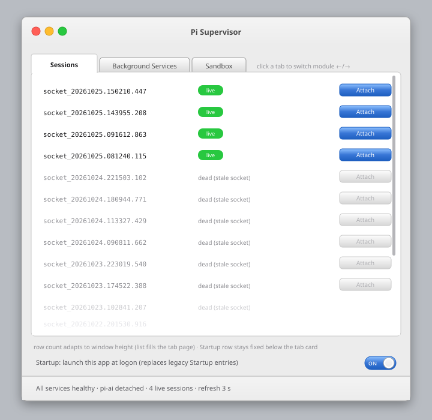
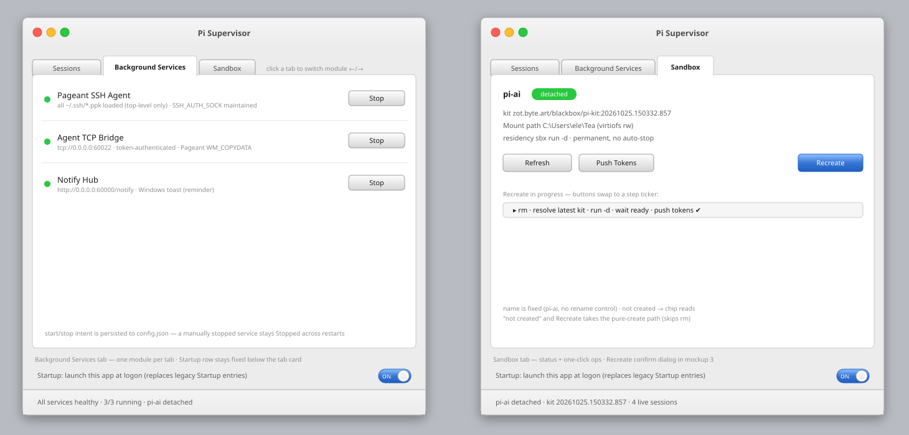
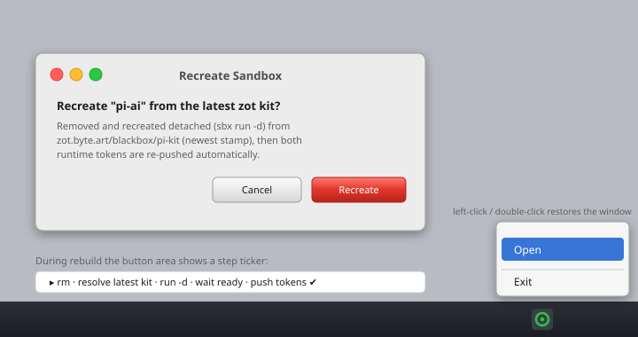

# Pi Supervisor 开发计划

> 目标：一个轻量级 Windows 桌面工具，接管 pi-build 沙箱体系在宿主机上的全部常驻守护与初始化操作，
> 开发方式与界面样式与 `C:\Users\ele\Tea\home\dns-switch` **完全一致**（Tauri 2 + Svelte 5 + Aqua 设计系统 + 托盘驻留）。
> 工具代号 **Pi Supervisor**（工程名 `pi-supervisor`，UI 全英文）。建议落点：`C:\Users\ele\Tea\home\pi-supervisor`（与 dns-switch 平级）。

---

## 1. 宿主机常驻守护与初始化脚本盘点（现状分析）

以下条目均在 2026-10-24 实测核实（进程/端口/Startup 目录均已确认）。

### 1.1 需要常驻的辅助守护（现状：分散在 Startup 文件夹的脚本/独立进程）

| # | 名称 | 现状载体 | 形态 | 端口/管道 | 功能 | 证据 |
|---|------|----------|------|-----------|------|------|
| D1 | Pageant SSH Agent 引导 | `%SS%\pageant-bootstrap.cmd` → `~\.ssh\pageant-bootstrap.ps1` | 登录后一次性脚本（拉起 pageant.exe + 探测管道写用户环境变量 `SSH_AUTH_SOCK` + 拉起 D2） | `\\.\pipe\pageant.<user>.<hash>` | 沙箱 ssh 的签名私钥源（私钥只存在于 Pageant 内存）。现状只加载 nook.ppk；**迁移后目标行为：默认加载 `%USERPROFILE%\.ssh\` 顶层的全部 `*.ppk`**（仅该目录一层，不递归子目录——`.ssh\bak\`、`.ssh\github*` 等子目录/无关文件不进 agent） | Startup 目录 + 进程表 pageant.exe PID 25528 |
| D2 | Pageant TCP Bridge | `~\.ssh\pageant-tcp-bridge.py`（pythonw，由 D1 拉起） | 常驻 TCP 服务 | TCP **60022**（双栈） | sbx 的 agent 转发不认 Windows 命名管 → 以 WM_COPYDATA 桥接 Pageant，协议 = 32 字节 token 行 + OpenSSH agent 帧；token 每次连接重读 | 端口表 60022 LISTENING |
| D3 | Notify Hub | `%SS%\server.vbs` → `C:\Users\ele\Applications\notify\server.js`（node） | 常驻 HTTP 服务 | TCP **60000**（双栈） | `POST /notify {title,message}` → Windows Toast（reminder 常驻弹框）；沙箱 `notify-complete.ts` 扩展的宿主端接收器 | 端口表 60000 LISTENING，node PID 40516 |

> `%SS%` = `%APPDATA%\Microsoft\Windows\Start Menu\Programs\Startup`。

**明确不迁移（相邻但超出 pi-build 职责，保留原状）：**

| 名称 | 载体 | 理由 |
|------|------|------|
| pi-obs wake-server（:19225） | `%SS%\pi-obs-wake.vbs` → `Tea\ai\pi\browser\tools\wake-server.mjs` | 属 pi-obs 项目，非沙箱支持面 |
| effort-proxy（:6087） | `%SS%\effort-proxy.cmd` → `~\.claude\effort-proxy.mjs` | 属 Claude Code 网络层，非 pi 沙箱 |
| sbx daemon（sandboxd） | Docker Sandboxes 自带 | 由 sbx CLI 自管，工具只做 `sbx daemon restart` 类操作入口 |
| sbx-pageant-bridge.py | `~\.ssh\`（未运行） | 原生 agent 转发的备用旁路，当前无人使用；不进 UI，仅在文档备案 |
| Pageant.exe 本体 | PuTTY 外部二进制 | 无法"迁移"，Pi Supervisor 只做其**监管者**（检测/拉起/环境变量维护） |

### 1.2 沙箱重建与初始化（pi-build 2026-10-25 现状，README §Detached long-running sandbox）

| # | 名称 | 现状载体 | 内容 |
|---|------|----------|------|
| I1 | push-tokens | `scripts/push-tokens.cmd <sandbox>` | 两个运行时 token（`~\.ssh\agent-bridge-token` → `/home/agent/.ssh/`；`~\.pi-hub\token` → `/home/agent/.pi/agent/`）经 `sbx exec` **stdin** 推送，32-hex 校验，600 权限 |
| I2 | 沙箱重建 | 手工命令序列（无脚本，README 固化） | `sbx rm --force <n>` → `sbx run -d --name <n> zot.byte.art/blackbox/pi-kit:<stamp> C:\Users\ele\Tea` → I1。要点：**detached 模式（`-d`）常驻、无 auto-stop**——关终端不会停沙箱，因此不存在 keep-alive 类需求；kit **只从 zot 仓库的签名 kit 创建**（永不从本地 kit 目录），stamp 按 pi-build 的 pin 更新，工具侧改为**每次向 zot 查询 `blackbox/pi-kit` 最新 tag**（§3）；`NO_PROXY` 必须覆盖 `zot.byte.art`，否则企业代理会掐断 kit manifest 拉取 |

> 结论：D1–D3 + I1–I2 全部迁入 Pi Supervisor；D1/D2/D3 的旧 Startup 条目在切换阶段禁用（§9）。
> 注：早期设想的 keep-alive 类常驻随 detached 模式落地而消失，本计划**不含**该模块。

---

## 2. 技术选型（与 dns-switch 逐项对齐）

| 维度 | 选型 | 对齐点 |
|------|------|--------|
| 外壳 | **Tauri 2**（Rust 主进程 + WebView2） | 同 dns-switch；`decorations:false, transparent:true, shadow:false`，DWM 圆角禁用（`DwmSetWindowAttribute 33`），Win10/11 外观一致 |
| 前端 | **Svelte 5 runes + Vite + TypeScript** | 同；`src/api.ts` 适配层 + 纯浏览器 mock（`vite dev` 免 Rust 迭代 UI） |
| 样式 | **`theme.css` Aqua 设计系统**（Lucida Grande / #ECECEC chrome / 白卡片 / #3876D6 蓝 / 24px 透明边距投影），直接移植；**有意偏差**：标题栏下边界分隔线移除，标题栏渐变终点改为 `#ECECEC` 与主体浅灰无缝融合（dns-switch 原版有 `--border-separator` 分隔线） | 其余像素级一致 |
| 组件 | 移植 `TitleBar.svelte`（红绿灯）/ `ConfirmDialog.svelte` / `ContextMenu.svelte` | 同 |
| 托盘 | `TrayIconBuilder` + 关窗 `CloseRequested→hide`（最小化到托盘）+ 右键菜单 **Open / Exit**（+左键/双击恢复窗口） | 与 dns-switch `main.rs` 行为逐行一致 |
| 权限 | **不需要管理员**（不移植 `admin.rs`；sbx/端口绑定均为用户权限） | 有意偏差，其余一致 |
| 测试 | Playwright 浏览器层 E2E（mock）+ 真机层人工验收 | 同 dns-switch 测试策略两层法 |
| 出包 | `npx tauri build`（MSI/EXE，本地） | 同 |

---

## 3. 架构设计

```
┌─ Svelte 前端（英文 UI）──────────────────────────────┐
│ 服务卡片 ×3（状态点/起停/详情） + Sandbox 卡片 + 状态栏 │
│ api.ts：invoke 封装，浏览器 mock 兜底                  │
└──────────────△ Tauri invoke / 事件（service-status）──┘
┌──────────────▽ Rust 监管核心 ─────────────────────────┐
│ supervisor.rs   服务生命周期状态机（Idle/Starting/     │
│                 Running/Failed，崩溃自动重启，事件广播）│
│ services/                                                  │
│   pageant.rs    D1：read_dir(%USERPROFILE%\.ssh) 取顶层   │
│                 *.ppk（不递归子目录）→ 全量作参数拉起      │
│                 pageant.exe；枚举 \\.\pipe\pageant.*、     │
│                 SetEnvironmentVariable(User,SSH_AUTH_SOCK)│
│                 健康=进程存活                             │
│   bridge.rs     D2：pageant-tcp-bridge.py 的 Rust 移植：  │
│                 TcpListener(60022) + 每连接线程 +         │
│                 WM_COPYDATA/CreateFileMapping/MapView     │
│                 （windows crate）+ token 行校验（每连接   │
│                 重读 token 文件）+ 1MB 帧上限 + 日志轮转   │
│   notify.rs     D3：std::net 迷你 HTTP（GET / 健康、      │
│                 POST /notify）→ Windows Toast（windows    │
│                 crate ToastNotificationManager，XML 净化   │
│                 逻辑照搬 server.js xmlSafe：非法字符/     │
│                 孤立代理项/]]>/换行折叠——不再有           │
│                 powertoast 的 here-string 注入面）         │
│ zot.rs          kit 版本解析：GET /v2/blackbox/pi-kit/    │
│                 tags/list（NO_PROXY 覆盖 zot.byte.art）→  │
│                 过滤 `YYYYMMDD.HHMMSS.mmm` 时间戳 tag →   │
│                 取最新；失败回退 config.kit_tag           │
│ sandbox.rs      I2：状态采集（sbx inspect/list 解析；未创 │
│                 建→not created）+ 重建编排（rm --force →  │
│                 zot 取最新 kit → sbx run -d --name pi-ai  │
│                 <kit-ref> <mount> → 等待 ready →          │
│                 push-tokens），步骤事件流上报 UI          │
│ sessions.rs     3s 定时轮询 `sbx exec -it pi-ai -- bash   │
│                 -lc "pi-dtach -l"`，解析 socket_*/live/    │
│                 dead 两列（容忍 CRLF/ANSI/启动前缀；上一  │
│                 轮未返回则跳过）→ 事件推 UI；Attach 经    │
│                 wt.exe 开新终端跑 `sbx exec -it pi-ai --  │
│                 bash -lc "pi-dtach -a <socket_*>"`         │
│ tokens.rs       I1：port 自 push-tokens.cmd（32-hex 校验、 │
│                 stdin 管道、600 权限由沙箱侧 umask 保证）  │
│ config.rs       config.json（exe 同级）：沙箱名（固定     │
│                 pi-ai，只读）、挂载路径、kit 兜底 tag、    │
│                 端口、服务启停意图（各服务期望 Running/    │
│                 Stopped）、窗口尺寸状态（宽高/位置/最大    │
│                 化，启动时恢复）。开机自启开关不入           │
│                 config.json——以注册表为唯一事实源：UI 状态  │
│                 直接读 HKCU\...\Run 项存在与否              │
└────────────────────────────────────────────────────────┘
```

**API 契约保持兼容**（沙箱侧零改动）：
- notify：`GET /` 健康、`POST /notify {"title","message"}`（兼容 `text`/`body` 字段），端口 60000 —— `notify-complete.ts` 无感。
- bridge：TCP 60022、token 行 + agent 帧协议 —— `nook-agent-relay.py` 无感。

## 4. GUI 设计（英文界面）

- **标题栏**：左上角红绿灯三键（Close=隐藏到托盘 / Minimize / Zoom，语义同 dns-switch `TitleBar.svelte`），标题居中；**无下边框分隔线**——标题栏渐变 `#F4F4F4 → #ECECEC` 结束即主体背景色，视觉上与内容区融为一体（移植时删除 TitleBar 的 `border-bottom`，theme.css 新增 `--titlebar-bottom: #ececec`）。
- **窗口行为**：允许用户调整尺寸 + 最大化/最小化（`resizable/maximizable/minimizable: true`），**最低尺寸下限**（`minWidth: 560 / minHeight: 640`，默认 660×860）；红绿灯语义 = 红(关闭)→隐藏到托盘、黄→最小化、绿→最大化切换。透明阴影边距适配：监听 `tauri://resized`/maximized 状态，最大化时移除 `#root` 的 `--window-margin`（否则四周露出透明边）。**窗口尺寸状态持久化**：`tauri://resized`/`moved` 去抖 500ms 后写 config.json（宽高/位置/最大化标记），下次启动按存档恢复（越出显示器范围时回退默认尺寸居中）。
- **Tab 页布局**：Sessions / Background Services / Sandbox 三个模块合并为**一个 tabbed 卡片**——卡片顶部一排 tab 标签（Aqua 风格：选中页签白底抬高、与内容区无缝相连；未选中灰渐变略矮），点击标签左右切换内容页（`TabBar.svelte`，切换带 150ms 水平滑移动效）；任一时刻只显示一个模块，内容区占满卡片剩余高度（三页外观见示意图一/二）。**Startup 行不在 tab 范围内**：固定在 tab 卡片下方（窗口底部、状态栏之上），始终可见、不随页签切换。
- **Sessions 页**（tab 一）：pi-dtach 会话列表。**每 3 秒**轮询 `sbx exec -it <沙箱名> -- bash -lc "pi-dtach -l"`（Rust 侧 `sessions.rs` 定时器），解析其固定宽两列输出 `socket_<stamp>  live | dead (stale socket)`（`pi-dtach -l` 逐项 node 连通探测判定 live/dead）；解析器容忍 CRLF/ANSI 及首行 "Sandbox … started" 前缀，上一轮未返回则跳过本轮（不叠加子进程）。列表项 = `socket_*` 名称（等宽字体）+ 状态（`live` 绿 chip / `dead (stale socket)` 灰字）+ 右侧 `Attach` 按钮（**dead 行按钮置灰禁用**）。Attach 语义：`sbx run -d` 沙箱的交互式 attach 需要真 TTY，故经 **`wt.exe` 新开 Windows Terminal 窗口**执行 `sbx exec -it <沙箱名> -- bash -lc "pi-dtach -a <socket_*>"`（socket 全名可被 pi-dtach 的 resolve 直接命中；脚本自带 kick_redraw 黑屏修复）。**无固定行数限制**：可见行数随窗口大小自适应——列表容器 flex 撑满 tab 内容区，行数 = 容器高 ÷ 行高（32px 定高行），窗口拉大即多显；超出容器时滚动并显示 **Mac OS overlay 风格滚动条**（细圆条、半透明、滚动时浮现空闲淡出，纯 CSS `::-webkit-scrollbar`）。轮询与 live 计数不随页签切走而暂停（底部状态栏始终汇总 live sessions）。空态文案 `No sessions yet`；沙箱未创建时显示 `Sandbox not created`。
- **Background Services 页**（tab 二）：3 行（Pageant SSH Agent / Agent TCP Bridge / Notify Hub），每行 = 状态点（绿=Running、灰=Stopped、红=Failed、黄=Starting）+ 名称 + 副标题（端口/管道/上次崩溃）+ `Start`/`Stop` 光泽按钮；启停结果即时写入 config.json（服务启停意图持久化，重启工具按此恢复）。
- **Sandbox 页**（tab 三）：**沙箱名固定 `pi-ai`**（不可修改：无改名勾选框/输入框，config 该项只读）+ 状态 chip（`detached` / `stopped`；**未创建时显示英文 `not created`**，此时名称区仍为 pi-ai，Recreate 即纯创建路径）+ 当前 kit 引用（`zot.byte.art/blackbox/pi-kit:<stamp>`）+ 挂载路径（**UI 文案固定为 "Mount path"**，替代 workspace 一词）；按钮 `Refresh`、`Push Tokens`、`Recreate`（蓝色默认键，触发红色确认框，见示意图三——确认框仅含影响说明 + `Cancel`/`Recreate`，**无改名控件**）。**工具不含任何镜像/kit 构建功能**——Rebuild all 类前置构建操作不在本工具职责内（留在 pi-build 的 build.sh）。Recreate 期间该页内嵌步骤 ticker（`▸ rm · resolve latest kit · run -d · wait ready · push tokens ✔`）。
- **Startup 行**（固定于 tab 卡片下方，不随页签切换）：开机自启采用**左右滑块开关**（`ToggleSwitch.svelte`，纯 CSS 实现）：48×22 胶囊轨道 + 白色圆形滑钮；开=滑钮右置、轨道恢复标准 Aqua 蓝渐变（`#8EC1FF→#3876D6→#1E5FC0`，与普通默认按钮同深）、轨道左缘 **纯白 `#FFFFFF` 小号 "ON"，加 0.35px 深蓝描边 `#1E5FC0`** 保证在轨道上半浅色段的可读对比度；关=滑钮左置、轨道浅灰渐变（`#F4F4F4→#D8D8D8`）+ "OFF" 用深灰 `#5F5F64`；点击带 150ms 滑动过渡。行为不变：写/删 `HKCU\...\Run`，替换旧 Startup 条目。**开关状态不写入 config.json**——注册表是唯一事实源：UI 状态 = `HKCU\...\Run` 下本工具项存在与否（启动时及每次切页/获焦时重读，用户在注册表里手改也能同步显示）。
- 底部状态栏一行汇总；日志明细走右键（移植 ContextMenu：`Copy status / Open logs`）。

### 示意图一：主窗口（Aqua 风格，Tab 三页签 + Sessions 自适应行高 + macOS 滚动条 + 滑块开关）



### 示意图二：Background Services / Sandbox 两个 tab 页



### 示意图三：托盘菜单 + Recreate 确认框（沙箱名固定 pi-ai，无改名控件）



（源文件：`plan-assets/*.svg`，矢量可放大核对色值/间距；色值一律取自 dns-switch `theme.css` 变量。）

## 5. 代码结构（复刻 dns-switch 布局）

```
pi-supervisor/
├── index.html  vite.config.ts  svelte.config.js  tsconfig.*  package.json
├── src/
│   ├── App.svelte  main.ts  theme.css(移植+Aqua 复用)  types.ts  api.ts(mock 兜底)
│   └── components/ TitleBar.svelte  TabBar.svelte（三页签）
│                   ServiceRow.svelte  SandboxCard.svelte
│                   ConfirmDialog.svelte  ContextMenu.svelte  StepTicker.svelte
│                   ToggleSwitch.svelte（滑块开关，Startup 自启用）
│                   SessionsPanel.svelte（行数自适应容器高+macOS overlay 滚动条样式）
├── src-tauri/
│   ├── tauri.conf.json  capabilities/default.json  icons/
│   └── src/ main.rs(托盘/关窗隐藏/DWM，同构照搬) lib.rs
│            commands.rs  config.rs  supervisor.rs
│            services/{pageant.rs, bridge.rs, notify.rs}
│            sandbox.rs  zot.rs  tokens.rs  sessions.rs
└── tests/ playwright.config.ts + e2e/*.spec.ts（浏览器 mock 层）
```

## 6. 开发步骤

| 阶段 | 内容 | 验收标准 |
|------|------|----------|
| P0 | 脚手架：从 dns-switch 复制工程骨架（含 .gitignore/icons 占位），删 DNS 业务码，改 tauri.conf（名称/窗口 660×860、resizable + minWidth 560/minHeight 640、minimizable/maximizable），TitleBar 去下边框，红绿灯接 min/max/tray；TabBar 三页签骨架（空内容页 + 150ms 滑移） | `npm run tauri:dev` 起窗：左上角红绿灯可见可点（红→托盘、黄→最小化、绿→最大化切换）、标题栏与主体无接缝、拖拽缩放不破最小尺寸、tab 点击左右切换顺畅、托盘/关窗最小化可用 |
| P1 | 监管核心 + Pageant 监管（D1）+ 状态事件流 | 杀掉 pageant 后 UI 变红并可一键复活；重启后 Pageant 内已装载 `~\.ssh` 顶层全部 ppk（`pageant.exe` 命令行逐项可见），子目录中误放的 ppk 不被加载；SSH_AUTH_SOCK 环境变量被正确刷新 |
| P2 | Notify Hub（D3，契约测试先行） | `curl -X POST :60000/notify -d '{"title":"t","message":"m"}'` 出 Toast；非法 JSON/超大 body/含 `` ` $ ]]> `` 的消息不崩不注入；沙箱内 `notify-complete.ts` 真实回合通知到达 |
| P3 | TCP Bridge（D2，最高风险，最后于服务类做） | 与 python 版行为对拍：token 错→断连、agent 帧正确应答；沙箱内 `ssh -o BatchMode=yes nook whoami` → `ai`；双实例启动失败报端口占用 |
| P4 | Sandbox 页（tab 三，I1/I2）：状态采集（沙箱名固定 `pi-ai` 只读；未创建态 chip = `not created`）、zot 最新 kit tag 解析、Push Tokens、Recreate（`rm --force` → `sbx run -d` → 步骤事件；确认框无改名控件；子进程环境注入 `NO_PROXY=localhost,127.0.0.1,zot.byte.art`） | 一键 Recreate 后 tokens 生效（沙箱内 ssh nook + `pi-sessions-sync pull` 双通过）且新沙箱为 detached（关全部终端 60s 后仍 running）；沙箱未创建时卡片 chip 显示 `not created` 且 Recreate 走纯创建（跳过 rm 容忍失败）；zot 不可达时报错并提示回退 tag；`sbx` 不在 PATH 等失败态有明确错误 |
| P5 | Sessions 页（tab 一）：3s 轮询 `sbx exec -it pi-ai -- bash -lc "pi-dtach -l"`（sessions.rs：上一轮未回则跳过本轮，解析 socket_*/live/dead，容忍 CRLF/ANSI/sbx 前缀行）；行渲染（mono 名称 + live 绿 chip / dead 灰 + Attach 按钮，dead 禁用）；Attach → `wt.exe` 新窗口 `sbx exec -it pi-ai -- pi-dtach -a <socket_*>`；行数随窗口高自适应（容器 flex 撑满内容区，32px 定高行），超出出 macOS overlay 滚动条；空态 `No sessions yet` / 未创建沙箱 `Sandbox not created` | pi-dtach 开 2 个会话后 3s 内列表自动出现且状态 live；Attach 弹出新 Windows Terminal 并正确 re-attach（含重排修复生效）；kill 会话进程后该行变 dead 且 Attach 置灰；造 20 个 socket 文件→滚动条出现，拉伸窗口高度可见行数随之增减；切到其他 tab 轮询照常（状态栏 live 计数持续更新）；杀 sbx 不可用时面板报错但不卡死轮询循环 |
| P6 | config.json 持久化（服务启停意图 + 窗口尺寸状态：宽高/位置/最大化，resized/moved 去抖写入、启动恢复）+ 开机自启（HKCU Run 写/删，开关态只读注册表、不入 config）+ 旧 Startup 条目一键禁用（加 `.disabled` 后缀而非删除，可回滚） | 重启后服务按配置自动拉起、被手动 Stop 过的服务保持 Stopped 不自启；重启工具后窗口尺寸/位置/最大化状态与上次一致；手动删掉 HKCU Run 项后重开工具，滑块正确显示 OFF；旧脚本不再双起（60000/60022 无双监听） |
| P7 | Playwright E2E（mock 层，含 tab 切换、sessions mock 数据：live/dead/20 行、Startup 行固定不随 tab 消失）+ 真机验收 + `tauri build` 出包 | mock 层全绿；出包安装后全流程（含 §7 验收）人工过一遍 |

## 7. 验收清单（真机）

- [ ] 关闭窗口 → 进程驻留托盘；右键 Open/Exit、左键/双击恢复
- [ ] 三服务 Start/Stop 全部即时生效，状态点在 2s 内更新
- [ ] bridge/notify 崩溃注入（杀子线程模拟）→ 自动重启并标黄→绿
- [ ] Recreate 全流程无人工介入，从 zot 最新签名 kit 以 detached 方式重建，token 推送成功，关闭所有终端后沙箱仍 running，pi-ai 内 tmux/ssh/hub-sync 三项复验通过
- [ ] SANDBOX 块名称恒为 `pi-ai`（只读无改名控件）；未创建时 chip 显示 `not created`
- [ ] 三页签点击左右切换正常，任一时刻只见一个模块；Startup 行固定在 tab 卡片下方、切页签不消失
- [ ] SESSIONS 列表 ~3s 自动刷新；live/dead 状态正确、dead 行 Attach 置灰；Attach 弹出新 Windows Terminal 且 re-attach 画面正常（非黑屏）；行数随窗口高度自适应、超出出 macOS 滚动条；切走页签后轮询不停（状态栏 live 计数持续更新）
- [ ] 窗口可拖拽缩放/最大化/最小化，缩到 560×640 封顶不破版，最大化时无多余边距；退出重开后窗口尺寸/位置/最大化状态还原
- [ ] 某服务手动 Stop 后退出重开，仍保持 Stopped 不被自动拉起（启停意图持久化）
- [ ] 沙箱侧扩展（notify-complete.ts / nook-agent-relay.py）零改动可用
- [ ] 开机自启接管后，Startup 旧条目已禁用且未删除

## 8. 测试策略（两层，同 dns-switch）

1. **浏览器层（日常）**：`vite dev` + api.ts mock，Playwright 跑状态机渲染、按钮态、确认框、ticker。
2. **真机层（验收）**：打包 exe，按 §7 人工 + 脚本化冒烟（curl notify、沙箱 ssh、端口探活）。
3. **后端单测**：`xmlSafe` Rust 版用 server.js 注释里的攻击样例做表驱动测试；bridge token 帧解析单测（不依赖 Pageant 的部分）。

## 9. 切换与回滚（Cutover）

- 切换顺序：Pi Supervisor 安装并验证 → 禁用 `%SS%` 中 `server.vbs`、`pageant-bootstrap.cmd`（重命名加 `.disabled`）→ 工具开开机自启。
- 回滚：删 HKCU Run 项 + 还原两个 Startup 文件名即恢复旧体系（Pi Supervisor 不删任何旧文件；`Applications\notify\server.js` 与 `pageant-tcp-bridge.py` 原样保留为回滚备胎）。
- 共存保护：bridge/notify 启动时端口绑定失败 → 服务标红并提示"被旧脚本占用"，不强杀外部进程。

## 10. 风险与备注

| 风险 | 缓解 |
|------|------|
| D2 WM_COPYDATA Rust 移植是最大不确定点（file mapping 命名约定、消息帧边界） | P3 排最后且先写"与 python 版并跑对拍"工装：同一 ssh 流量分别打 60022/60023 比对字节应答；保底方案=先用 Rust 包装现有 pythonw 子进程上线，bridge 原生化二次迭代 |
| 端口双监听（旧脚本与工具同时跑） | 启动失败即标红提示，切换阶段用 §9 禁用旧条目 |
| `sbx` CLI 输出为人类文本非 JSON | 解析器只做关键字匹配 + 宽松失败；先验证 `sbx inspect --json` 是否存在，有则优先 |
| Toast 实现差异（powertoast→windows crate 直投） | 保留 PowerShell toast 兜底路径（不经 here-string 拼 XML，改为文件传参） |
| token 处理 | 沿用纪律：只走 stdin、不进 argv、不写日志；32-hex 校验照搬 |
| 服务与 UI 生命周期耦合（Exit 时子进程残留） | Exit 前统一 supervisor.shutdown()：kill 在跑的 sbx 子进程、释放 60000/60022 |
| zot 拉最新 kit tag 解析（时间戳 tag 排序）| tag 按 `YYYYMMDD.HHMMSS.mmm` 定宽字典序即时间序，取 max 安全；zot 不可达/无 `tags/list` 时回退 config 里的兜底 tag 并在 UI 黄标提示 |
| sbx 子进程环境无 `NO_PROXY` 覆盖 `zot.byte.art` | 企业代理会掐断 kit manifest → Recreate 直接失败；Rust 侧对每个 sbx 子进程显式注入 `NO_PROXY`（README 已固化此坑） |
| sbx 版本升级可能改 exec/run 语义 | push-tokens/run 都经 sbx CLI，失败即红色状态+原文报错上屏；不做静默重试 |
| Sessions 3s 轮询走 `sbx exec -it`：每次分配 PTY、有秒级开销，沙箱忙时可能超时堆积 | sessions.rs 单飞（上一轮未回跳过本轮）+ 5s 子进程超时强杀；轮询失败只标面板错误态，不弹通知不打断服务；沙箱未创建时直接短路显示 `Sandbox not created` 不发 exec |
| `pi-dtach -l` 输出为定宽人类文本（40 字符补白 + 状态列），且 sbx 可能混入启动提示行/CRLF/ANSI | 解析器按行首 `socket_` 白名单匹配、行尾取 `live`/`dead` 关键字，其余行忽略；解析失败整轮弃用（保留上一帧渲染） |
| Attach 依赖真实 TTY（`sbx exec -it`），Tauri 子进程无 PTY | 不内嵌终端，一律拉起 `wt.exe` 新窗口执行 attach 命令；`wt.exe` 缺失（老 Win10）时回退 `start cmd /k` 并提示 |

## 11. 里程碑

- **M1（服务接管）**：P0–P3 完成，旧 Startup 里 pi 相关脚本全部禁用 —— 宿主常驻从"3 个脚本 2 种语言"收敛为 1 个 exe。
- **M2（运维闭环）**：P4–P5 完成，日常"重建沙箱"（rm → 取 zot 最新 kit → run -d → push-tokens）收敛为 1 次点击，dtach 会话可视列表 + 一键 Attach。
- **M3（发布）**：P6–P7 出包 + README（含示意图引用与切换说明）。

---

### 附：现状证据速查

```text
端口实测   :60000 LISTENING (node server.js, PID 40516)   :60022 LISTENING (PID 30812)
进程实测   pageant.exe nook.ppk (25528) · node server.js (40516)
Startup    pageant-bootstrap.cmd / server.vbs / pi-obs-wake.vbs / effort-proxy.cmd / Ollama / 滴答清单
初始化     scripts/push-tokens.cmd（token×2，stdin 通道，32-hex 校验）
重建序列   sbx rm --force pi-ai → sbx run -d --name pi-ai zot.byte.art/blackbox/pi-kit:<latest-stamp> C:\Users\ele\Tea → push-tokens（-d=常驻无 auto-stop；NO_PROXY 须含 zot.byte.art）
参考样式   dns-switch/src/theme.css（Aqua）· main.rs（托盘/关窗隐藏）· api.ts（mock 层）
```
